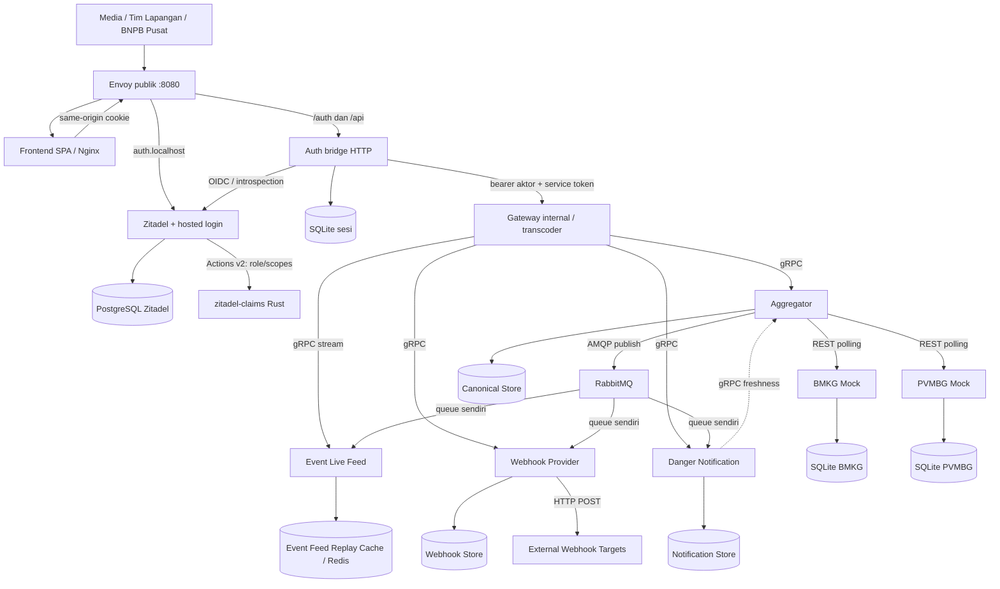

# Arsitektur dan keputusan kontrak

Diagram berikut adalah **target sistem lengkap** berdasarkan gambar pengguna.
BMKG dan PVMBG sudah diimplementasikan sebagai dua mock Python 3.12 mandiri,
masing-masing dengan SQLite. Frontend adalah React SPA. Autentikasi menggunakan
Zitadel beserta halaman login bawaannya dan Auth bridge HTTP di sisi server.
Aggregator, distribusi event, dan integrasi API bisnis masih perlu diselesaikan;
tersedianya login tidak membuktikan keseluruhan alur BNPB telah berjalan.
Endpoint BNPB, wrapper respons, pagination, SSE, dan replay adalah pilihan desain
repo; endpoint dan entitas mock mengikuti PDF.

Semua komponen aplikasi menjadi container tersendiri saat implementasi. Setiap
database/cache mempunyai satu pemilik. Gateway internal tidak mengakses database
Aggregator, sesi Auth bridge, atau pengguna Zitadel. Feed memegang buffer replay sementara, Notifier menyimpan
hasil turunan, Webhook Provider menyimpan langganan webhook dan log pengiriman;
ketiganya tidak menjadi penulis Canonical Store. Storage kanonik belum
dipilih: document store atau relational store dengan kolom JSON harus menerima
`attributes` dinamis tanpa migrasi ketika field aditif muncul.

## Login dan sesi browser

`compose.auth.yaml` menjalankan Envoy publik, SPA, Auth bridge Node.js 24,
target Actions `zitadel-claims` (Rust), Zitadel 4.16 beserta Login UI v2, dan
PostgreSQL 17. Browser membuka
`http://localhost:8080`; issuer dan hosted login memakai
`http://auth.localhost:8080`. Kedua alamat harus konsisten dengan konfigurasi
OIDC. Cookie aplikasi bersifat host-only dan tidak dibagikan ke host Zitadel.

Nama `auth.localhost` memakai split-horizon DNS. Browser memetakannya ke loopback,
yaitu port publik Envoy. Di dalam `bnpb_net` nama itu adalah alias jaringan Zitadel,
sehingga Auth bridge dan service backend mengambil discovery, JWKS, dan token langsung
dari Zitadel tanpa hairpin melalui Envoy. Issuer tetap satu URL, jadi port Zitadel
harus sama dengan port publik Envoy (8080).

1. Tombol masuk mengarahkan browser ke `GET /auth/login`. Bridge membuat
   `state`, `nonce`, dan PKCE, lalu mengarahkan browser ke Zitadel.
2. Pengguna memasukkan kredensial di halaman Zitadel. Callback
   `/auth/callback` menukar authorization code di server, memverifikasi
   ID token (signature, issuer, audience, expiry, nonce), dan memeriksa access
   token melalui introspeksi. SPA tidak memegang client secret.
3. Bridge menyimpan sesi di SQLite. Refresh token dienkripsi menggunakan
   `AUTH_SESSION_KEY`. Browser menerima access token asli dalam cookie
   `bnpb_access` dan ID sesi acak dalam `bnpb_session`; keduanya `HttpOnly`,
   `Path=/`, `SameSite=Lax`, host-only, dan `Secure` ketika menggunakan HTTPS.
4. SPA membaca identitas, role/scope, expiry, dan CSRF token dari
   `GET /auth/session`. JavaScript tidak membaca access token. Request API
   memakai cookie same-origin; bridge mengikat token ke sesi, memeriksa
   introspeksi, lalu meneruskan bearer aktor asli ke Gateway internal.
5. Jika access token habis tetapi sesi lokal masih valid, `/auth/session`
   mengembalikan 401 dengan `refresh_required` dan CSRF token. SPA memanggil
   `POST /auth/refresh`, kemudian melanjutkan dengan sesi yang baru. Default
   TTL access token adalah **60 detik** dan dapat dikonfigurasi pada Zitadel.
6. `POST /auth/logout` mengakhiri sesi lokal, menghapus cookie, dan mencabut
   token. Browser mengikuti `logout_url` untuk mengakhiri SSO Zitadel juga.

POST refresh/logout serta mutasi API berbasis cookie wajib membawa `Origin`
aplikasi yang tepat dan `X-CSRF-Token` milik sesi. CSRF token bukan kredensial
akses API. Tidak ada password pengguna atau refresh token di storage JavaScript.
Ketiga akun demo adalah pengguna Zitadel yang berbeda; role diperoleh dari
grant proyek/organisasi yang dikonfigurasi. Zitadel menambahkan klaim `role` dan
`scopes` ke token melalui target Actions v2 pada service Rust `zitadel-claims`.

Mode `VITE_APP_MODE=oidc` menentukan autentikasi, sedangkan `VITE_DATA_MODE`
menentukan data dashboard. Standalone Auth memakai `VITE_DATA_MODE=mock`
agar login nyata dapat dikembangkan ketika service BNPB belum siap. Fixture
di browser tidak membuktikan otorisasi atau integrasi data backend. Pada stack
standalone, request API bisnis terautentikasi mendapat 503; data simulasi tidak
dijadikan respons API server.

Satu gateway Envoy melayani SPA, `/auth/*` (ke bridge), hosted login Zitadel, dan
`/api/*`. Untuk API, Envoy memindahkan cookie `bnpb_access` ke header bearer,
menukarnya menjadi JWT di Zitadel (RFC 8693, filter Built On Envoy
`token-exchange`), lalu mentranskode REST ke gRPC. Envoy hanya mengautentikasi;
service memeriksa scope dari JWT. Penyesuaian shape REST/ProtoJSON, SSE, dan
validasi JWT di service tetap pekerjaan integrasi service bisnis. Lihat
[README Envoy](../services/envoy/README.md). Detail boundary ada di
[OpenAPI Auth](../contracts/openapi/auth.yaml) dan
[panduan Auth bridge](../services/auth-bridge/README.md).

## Implementasi sumber mock

Setiap mock memiliki `app.py`, `config.py`, dan `storage.py` di folder service
sendiri. `ThreadingHTTPServer` menangani request bersamaan; satu thread generator
menambah data berkala. Tidak ada impor kode bisnis antar-mock. SQLite menyimpan
payload JSON bersama ID dan timestamp berindeks sehingga penambahan
`confidence_level` tidak memerlukan perubahan tabel. Kedua container memiliki
volume sendiri: `bmkg_data` dan `pvmbg_data`. Hanya pemilik yang memasang volume.

BMKG memvalidasi `X-BMKG-Key`, sedangkan PVMBG memvalidasi bearer token miliknya.
Aggregator nantinya melakukan polling; kedua mock tidak memanggil broker, Auth,
atau storage BNPB. Port host adalah 8081/8082, sementara listener di masing-masing
container memakai 8080. Jalankan lingkup ini dengan
`docker compose -f compose.mocks.yaml up --build -d`.

PVMBG mulai dengan skema v1 dan outage nonaktif. Admin API mengubah state tersebut
tanpa restart. Saat outage, data dan health mengembalikan 503 tetapi admin serta
generator tetap berjalan. Restart mengembalikan state kontrol ke baseline,
sementara record historis tetap tersimpan. Rincian alur, penyimpanan, demonstrasi,
dan batas runtime ada di [panduan implementasi mock](mock-services.md).

## Polling, query, dan kegagalan

Aggregator menjalankan poller BMKG dan PVMBG secara independen dengan batas
konkurensi, deadline, retry/backoff, dan watermark per endpoint. Permintaan client
membaca API Aggregator atas Canonical Store sehingga tidak menunggu polling
PVMBG. Timeout PVMBG tidak membatalkan poll BMKG. Default poll 3 detik; jangan
menumpuk poll yang belum selesai pada sumber yang sama.

Status BMKG menggabungkan polling seismic-events dan tsunami-warnings secara
konservatif: sumber baru FRESH jika keduanya sukses dan masih dalam budget.
Kegagalan warning tidak boleh terlihat sebagai jaminan severity yang terkini.

`source` dan `hazard_type` membatasi sumber relevan. SEISMIC saja berarti BMKG,
VOLCANIC saja berarti PVMBG, tanpa keduanya berarti kedua sumber. Kombinasi
source/type yang tidak cocok ditolak 400/`INVALID_ARGUMENT`.

- `FRESH`: polling terbaru sukses dan masih dalam batas kebaruan.
- `STALE`: ada hasil tersimpan usable, tetapi polling gagal atau terlalu lama;
  sertakan `stale_since` dan `last_success_at`.
- `UNAVAILABLE`: belum ada hasil tersimpan usable. Poll sukses dengan hasil
  kosong tetap usable. Jika semua sumber relevan unavailable, kembalikan 503.

Jika sebagian sumber masih usable, kembalikan 200 dengan data yang tersedia dan
`partial=true` saat ada sumber STALE/UNAVAILABLE. Status sumber diukur saat respons
dibuat; record daftar berada pada snapshot pagination yang stabil. Freshness
notifikasi mengukur sumber upstream, bukan jaminan consumer sudah mengejar semua
event broker; consumer lag perlu metrik tersendiri.

## Domain kepercayaan

| Identitas | Kredensial | Batas akses |
| --- | --- | --- |
| Pemanggil BMKG | `X-BMKG-Key` | BMKG saja |
| Pemanggil PVMBG | bearer token PVMBG terpisah | PVMBG saja |
| Media | pengguna Zitadel sendiri; access token OIDC | Ringkasan; notifikasi dan webhook ringkasan |
| Tim Lapangan | pengguna Zitadel sendiri; access token OIDC | Ringkasan dan full; notifikasi dan webhook full |
| BNPB Internal | pengguna Zitadel sendiri; access token OIDC | Ringkasan dan full; notifikasi dan webhook full |
| Service internal | token per service | RPC yang diizinkan; tetap memerlukan actor |

Default scope adalah `hazards:read:summary`, `notifications:read`, dan `webhooks:read` untuk Media,
ditambah `hazards:read:full` serta `webhooks:write` untuk dua client lain. Login tidak menerima role/scope
buatan client. Pengguna tetap hanya membaca data kejadian; pengaturan langganan
webhook adalah operasi pengelolaan, bukan hak menulis hazard. Token BNPB tidak
berlaku sebagai bearer PVMBG. Access token opaque diperiksa lewat introspeksi
Zitadel pada setiap request terlindungi; token tidak diperlakukan sebagai JWT
buatan BNPB. Bridge menolak hash access token lama setelah refresh/logout,
termasuk pada jalur bearer. Cache TTL saja tidak menjamin pencabutan segera.

Gateway meneruskan actor token, identitas service sendiri, correlation ID, dan
deadline melalui gRPC. Tiap hop menggunakan kredensial pemanggilnya sendiri,
bukan meneruskan service token sebelumnya. Implementasi validasi pemanggil dan
aktor pada masing-masing service downstream masih menjadi tanggung jawab
pemilik service. Tidak ada Auth RPC maupun token exchange ke JWT internal.
Semua pembaca harus memeriksa scope/proyeksi; Media tidak mendapat
`source_ref_id`, koordinat, atau `attributes`, termasuk pada stream, pesan
notifikasi, dan error. Refresh/logout berlaku juga pada stream aktif.

## Broker dan live feed

Aggregator menulis record dan outbox secara durable sebelum mempublikasikan
binary Protobuf `bnpb.event.v1.HazardEventPublished` ke exchange fanout durable
`bnpb.hazards.v1`. Aggregator hanya mendeklarasikan exchange; setiap consumer
mendeklarasikan exchange yang sama, queue dan DLQ miliknya, lalu mengikat queue
tersebut sendiri. Tiga queue durable terpisah terikat ke exchange yang sama:
`bnpb.event-live-feed.v1`, `bnpb.webhook-provider.v1`, dan
`bnpb.danger-notification.v1`. Semuanya mendapat stream yang sama. Feed menyaring
sesuai filter yang diminta client; notifier membuat notifikasi untuk SIAGA/AWAS;
webhook provider memicu HTTP POST ke endpoint eksternal terdaftar. Consumer tambahan
membuat binding sendiri tanpa perubahan producer.

Gunakan pesan persistent, publisher confirms, retry terbatas, dead-letter queue,
dan ack setelah side effect tersimpan. Semantik **at-least-once** membutuhkan
deduplikasi `event_id`. Jangan menggunakan satu queue bersama untuk tiga jenis
consumer karena mereka akan berkompetisi menerima event. Queue yang sudah
dibuat menampung pesan saat consumer mati. Consumer baru menerima event sejak
queue diikat, bukan otomatis seluruh sejarah. Pada broker baru, event yang
dipublikasikan sebelum consumer pertama kali mengikat queue-nya hilang karena
exchange fanout tanpa binding membuang pesan; jalankan consumer sebelum
Aggregator mulai mempublikasikan.

`event_id` mengidentifikasi publikasi/revisi; `hazard_id` mengidentifikasi kejadian
kanonik. Pembaruan warning menghasilkan event baru dengan hazard ID tetap.
Replay feed memakai cursor opaque, sequence per epoch, dan buffer default 600
detik. Jika cursor tidak dapat dilanjutkan, kirim `reset_required`. Tidak ada
checkpoint atomik antara snapshot REST dan feed: client membuka/buffer stream,
memuat snapshot, lalu memakai hazard ID buffered sebagai invalidasi untuk
mengambil ulang record terkini. Jangan menimpa snapshot dengan payload buffered
yang mungkin lebih lama. Resume pada cursor yang masih tersedia tidak boleh
melewatkan event di peralihan replay ke live.

SSE dipilih untuk live feed satu arah pada boundary REST. SPA memakai streaming
fetch dengan cookie same-origin dan `Last-Event-ID`; client non-browser dapat
memakai bearer. Jangan memasukkan token ke URL.
Feed memakai server-streaming gRPC dan mengakhiri stream ketika token habis atau
dicabut, termasuk ketika idle.

## Observability

Log JSON minimal memuat `timestamp`, `level`, `service`, `correlation_id`,
`operation`, `duration_ms`, dan `status`. Catat dependency dan latensi panggilan
keluar tanpa token/secret. Poller membuat correlation ID per siklus dan
mempertahankannya pada broker; request client meneruskan ID sepanjang jalur RPC.

Mock sudah mencatat request dalam JSON, mengembalikan correlation ID, dan
menghubungkan trace context masuk yang valid dengan log. Mock tidak membuat
panggilan keluar. Ekspor span/metrik belum dihubungkan ke Collector.

Target integrasi: OpenTelemetry Collector menerima telemetry, Prometheus
menyimpan metrik, Jaeger menyimpan trace, dan Grafana menampilkan dashboard.
Lihat [deploy](../deploy/README.md). Keberadaan logging mock tidak membuktikan
integrasi observability sistem lengkap.
