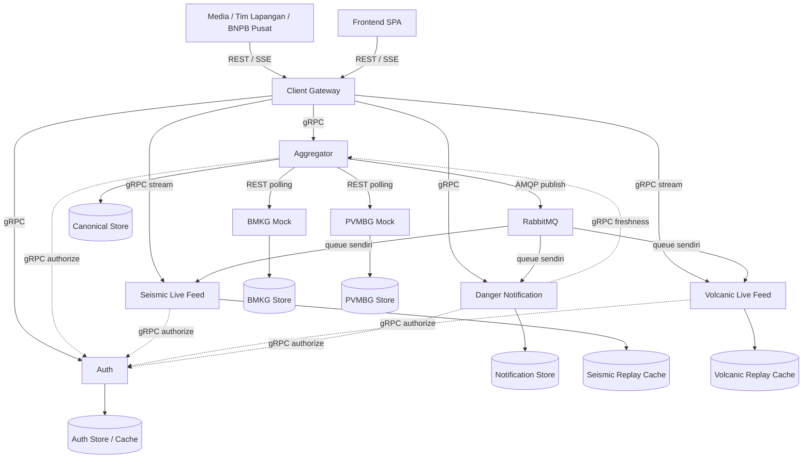

# Arsitektur dan keputusan kontrak

Diagram berikut adalah **target implementasi** berdasarkan gambar pengguna.
Saat ini hanya kontrak, struktur folder, validator, dan penampil API tersedia.
Endpoint BNPB, wrapper respons, pagination, SSE, dan replay adalah pilihan desain
repo; endpoint dan entitas mock mengikuti PDF.

Semua komponen aplikasi menjadi container tersendiri saat implementasi. Setiap
database/cache mempunyai satu pemilik. Gateway tidak mengakses database
Aggregator atau Auth. Feed memegang buffer replay sementara, Notifier menyimpan
hasil turunan; keduanya tidak menjadi penulis Canonical Store. Storage belum
dipilih: document store atau relational store dengan kolom JSON harus menerima
`attributes` dinamis tanpa migrasi ketika field aditif muncul.

## Polling, query, dan kegagalan

Aggregator menjalankan poller BMKG dan PVMBG secara independen dengan batas
konkurensi, deadline, retry/backoff, dan watermark per endpoint. Permintaan client
membaca API Aggregator atas Canonical Store sehingga tidak menunggu polling
PVMBG. Timeout PVMBG tidak membatalkan poll BMKG. Default poll 3 detik; jangan
menumpuk poll yang belum selesai pada sumber yang sama.

Status BMKG menggabungkan polling seismic-events dan tsunami-warnings secara
konservatif: sumber baru FRESH jika keduanya sukses dan masih dalam budget.
Kegagalan warning tidak boleh terlihat sebagai jaminan severity yang terkini.

`source` dan `hazard_type` membatasi sumber relevan. SEISMIC saja berarti BMKG,
VOLCANIC saja berarti PVMBG, tanpa keduanya berarti kedua sumber. Kombinasi
source/type yang tidak cocok ditolak 400/`INVALID_ARGUMENT`.

- `FRESH`: polling terbaru sukses dan masih dalam batas kebaruan.
- `STALE`: ada hasil tersimpan usable, tetapi polling gagal atau terlalu lama;
  sertakan `stale_since` dan `last_success_at`.
- `UNAVAILABLE`: belum ada hasil tersimpan usable. Poll sukses dengan hasil
  kosong tetap usable. Jika semua sumber relevan unavailable, kembalikan 503.

Jika sebagian sumber masih usable, kembalikan 200 dengan data yang tersedia dan
`partial=true` saat ada sumber STALE/UNAVAILABLE. Status sumber diukur saat respons
dibuat; record daftar berada pada snapshot pagination yang stabil. Freshness
notifikasi mengukur sumber upstream, bukan jaminan consumer sudah mengejar semua
event broker; consumer lag perlu metrik tersendiri.

## Domain kepercayaan

| Identitas | Kredensial | Batas akses |
| --- | --- | --- |
| Pemanggil BMKG | `X-BMKG-Key` | BMKG saja |
| Pemanggil PVMBG | bearer token PVMBG terpisah | PVMBG saja |
| Media | client ID/secret sendiri; token BNPB | Ringkasan |
| Tim Lapangan | client ID/secret sendiri; token BNPB | Ringkasan dan full |
| BNPB Internal | client ID/secret sendiri; token BNPB | Ringkasan dan full |
| Service internal | token per service | RPC yang diizinkan; tetap memerlukan actor |

Default scope adalah `hazards:read:summary` dan `notifications:read` untuk Media,
ditambah `hazards:read:full` untuk dua client lain. Login tidak menerima role/scope
buatan client. Token BNPB tidak berlaku sebagai bearer PVMBG. Jika menggunakan
JWT BNPB, periksa issuer, audience, signature, expiry, dan revocation. Access token
default 60 detik; refresh atomik membatalkan token sesi lama segera. Validasi
online Auth mempertimbangkan versi sesi; cache TTL saja tidak cukup untuk
menjamin pencabutan segera.

Gateway meneruskan actor token, identitas service sendiri, correlation ID, dan
deadline melalui gRPC. Tiap hop menggunakan kredensial pemanggilnya sendiri,
bukan meneruskan service token sebelumnya. Auth menegakkan allowlist RPC per
service. Semua pembaca memeriksa scope/proyeksi; Media tidak mendapat
`source_ref_id`, koordinat, atau `attributes`, termasuk pada stream, pesan
notifikasi, dan error. Refresh/logout berlaku juga pada stream aktif.

## Broker dan live feed

Aggregator menulis record dan outbox secara durable sebelum mempublikasikan
binary Protobuf `bnpb.event.v1.HazardEventPublished` ke exchange fanout durable
`bnpb.hazards.v1`. Tiga queue durable terpisah terikat ke exchange yang sama:
`bnpb.seismic-feed.v1`, `bnpb.volcanic-feed.v1`, dan
`bnpb.danger-notification.v1`. Semuanya mendapat stream yang sama lalu memfilter
jenis hazard masing-masing. Consumer tambahan membuat binding sendiri tanpa
perubahan producer. Notifier membuat notifikasi untuk SIAGA/AWAS.

Gunakan pesan persistent, publisher confirms, retry terbatas, dead-letter queue,
dan ack setelah side effect tersimpan. Semantik **at-least-once** membutuhkan
deduplikasi `event_id`. Jangan menggunakan satu queue bersama untuk tiga jenis
consumer karena mereka akan berkompetisi menerima event. Queue yang sudah
dibuat menampung pesan saat consumer mati. Consumer baru menerima event sejak
queue diikat, bukan otomatis seluruh sejarah.

`event_id` mengidentifikasi publikasi/revisi; `hazard_id` mengidentifikasi kejadian
kanonik. Pembaruan warning menghasilkan event baru dengan hazard ID tetap.
Replay feed memakai cursor opaque, sequence per epoch, dan buffer default 600
detik. Jika cursor tidak dapat dilanjutkan, kirim `reset_required`. Tidak ada
checkpoint atomik antara snapshot REST dan feed: client membuka/buffer stream,
memuat snapshot, lalu memakai hazard ID buffered sebagai invalidasi untuk
mengambil ulang record terkini. Jangan menimpa snapshot dengan payload buffered
yang mungkin lebih lama. Resume pada cursor yang masih tersedia tidak boleh
melewatkan event di peralihan replay ke live.

SSE dipilih untuk live feed satu arah pada boundary REST. SPA memakai streaming
fetch agar dapat mengirim Authorization dan Last-Event-ID; native EventSource
tidak mendukung arbitrary Authorization header. Jangan memasukkan token ke URL.
Feed memakai server-streaming gRPC dan mengakhiri stream ketika token habis atau
dicabut, termasuk ketika idle.

## Observability

Log JSON minimal memuat `timestamp`, `level`, `service`, `correlation_id`,
`operation`, `duration_ms`, dan `status`. Catat dependency dan latensi panggilan
keluar tanpa token/secret. Poller membuat correlation ID per siklus dan
mempertahankannya pada broker; request client meneruskan ID sepanjang jalur RPC.

OpenTelemetry Collector menerima telemetry, Prometheus menyimpan metrik, Jaeger
menyimpan trace, Grafana menampilkan dashboard. Lihat [deploy](../deploy/README.md).
Infrastruktur ini belum dijalankan oleh Compose penampil kontrak.
