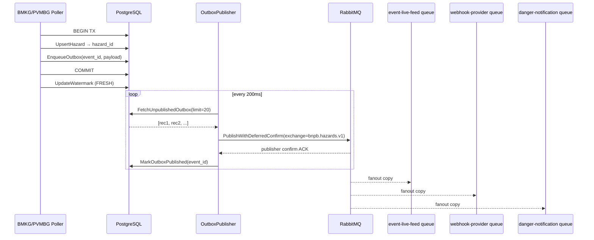

# RabbitMQ Event Publishing — Implementation Plan

## Goal

Wire the aggregator's **transactional outbox** to RabbitMQ so that every
new or updated hazard that is committed to PostgreSQL is reliably published as
a binary-Protobuf `bnpb.event.v1.HazardEventPublished` message to the
`bnpb.hazards.v1` fanout exchange.

## Background

The plumbing already exists in skeleton form:

| Component | File | State |
|---|---|---|
| Outbox table `outbox_events` | `migrations/001_init.sql` | ✅ Created |
| `EnqueueOutbox` (writes to outbox inside TX) | `store/outbox_store.go` | ✅ Implemented |
| `FetchUnpublishedOutbox` / `MarkOutboxPublished` | `store/outbox_store.go` | ✅ Implemented |
| `BuildPublishedEnvelope` (serialises proto) | `ingest/mapper.go` | ✅ Implemented |
| Pollers enqueue on upsert | `ingest/bmkg.go`, `ingest/pvmbg.go` | ✅ Implemented |
| `OutboxPublisher` (reads outbox, publishes) | `broker/publisher.go` | ✅ **Skeleton — has issues (see below)** |
| Exchange + queues declaration in compose | `compose.yaml` | ⚠️ Exchange declared by publisher, but **consumer queues not pre-declared** |

### Identified Gaps

1. **`broker/publisher.go` — missing consumer queue / DLQ setup**
   The publisher declares the fanout exchange `bnpb.hazards.v1` but does NOT
   declare the three durable consumer queues or bind them to the exchange.
   Per spec, queues must exist before the first publish so messages aren't
   dropped silently.

2. **Dead-letter queue not wired**
   The spec requires a dead-letter queue for undeliverable/bounced messages.

3. **Retry counter missing on outbox**
   If `publishOne` fails repeatedly, the record stays unpublished forever with
   no visibility. We need a `retry_count` column and a max-retry cap.

4. **`ingest_watermarks.last_success_at` schema mismatch**
   The migration marks `last_success_at TIMESTAMPTZ NOT NULL` but the failure
   path now inserts `NULL`. **Needs a schema migration.**

5. **No E2E test for broker path**
   `test_aggregator.go` validates gRPC RPCs; there is no assertion that a
   published message actually arrives on a queue.

---

## User Review Required

> [!IMPORTANT]
> **Queue naming**: The architecture doc states three separate durable queues:
> - `bnpb.event-live-feed.v1`
> - `bnpb.webhook-provider.v1`
> - `bnpb.danger-notification.v1`
>
> These consumer services are not yet implemented. Should the aggregator
> **pre-declare** these queues on startup (recommended — messages are buffered
> immediately) or leave declaration to each consumer service?
> The plan below assumes **aggregator pre-declares all three queues** so
> messages are never lost during the roll-out window.

> [!IMPORTANT]
> **Dead-letter queue strategy**: The spec says to use a DLQ. The plan adds
> a single `bnpb.hazards.dlq` queue. Do you want per-consumer DLQs or one
> shared DLQ?

> [!IMPORTANT]
> **Outbox retry limit**: After `N` failed publish attempts the record is
> moved to a FAILED state. The plan defaults to `N = 5`. Adjust if needed.

---

## Proposed Changes

---

### 1. Database Migration — `store/migrations`

#### [NEW] `002_outbox_retry.sql`

Adds `retry_count` and `failed_at` to the outbox table, and fixes the
`last_success_at` nullability issue.

```sql
-- 002_outbox_retry.sql
ALTER TABLE outbox_events
  ADD COLUMN IF NOT EXISTS retry_count  INTEGER      NOT NULL DEFAULT 0,
  ADD COLUMN IF NOT EXISTS failed_at    TIMESTAMPTZ;

-- Fix: last_success_at must be nullable (failure path inserts NULL)
ALTER TABLE ingest_watermarks
  ALTER COLUMN last_success_at DROP NOT NULL;

-- DLQ placeholder table (optional; for observability only)
CREATE TABLE IF NOT EXISTS outbox_dead_letters (
  event_id    TEXT PRIMARY KEY,
  hazard_id   TEXT NOT NULL,
  source      TEXT NOT NULL,
  payload     BYTEA NOT NULL,
  created_at  TIMESTAMPTZ NOT NULL,
  failed_at   TIMESTAMPTZ NOT NULL DEFAULT now(),
  last_error  TEXT
);
```

---

### 2. `store/outbox_store.go`

#### [MODIFY] `outbox_store.go`

Add two new methods:

```go
// IncrementOutboxRetry bumps retry_count and records the last error.
func (db *DB) IncrementOutboxRetry(ctx context.Context, eventID, lastErr string) error

// FailOutboxRecord moves a maxed-out record to dead_letters and deletes from outbox.
func (db *DB) FailOutboxRecord(ctx context.Context, rec *OutboxRecord, reason string) error
```

Update `OutboxRecord` struct:

```go
type OutboxRecord struct {
    EventID    string
    HazardID   string
    Source     string
    Payload    []byte
    CreatedAt  time.Time
    RetryCount int    // NEW
}
```

Update `FetchUnpublishedOutbox` to also scan `retry_count`, and filter
`WHERE published_at IS NULL AND failed_at IS NULL`.

---

### 3. `broker/publisher.go`

#### [MODIFY] `publisher.go`

**a) Declare consumer queues + DLQ on connect**

```go
const (
    ExchangeName = "bnpb.hazards.v1"
    DLQName      = "bnpb.hazards.dlq"
)

var consumerQueues = []string{
    "bnpb.event-live-feed.v1",
    "bnpb.webhook-provider.v1",
    "bnpb.danger-notification.v1",
}

func (p *OutboxPublisher) connect() error {
    // ... dial, open channel ...
    
    // 1. Declare DLQ
    _, err = ch.QueueDeclare(DLQName, true, false, false, false, nil)
    
    // 2. Declare fanout exchange
    err = ch.ExchangeDeclare(ExchangeName, "fanout", true, false, false, false, nil)
    
    // 3. Declare + bind each consumer queue
    for _, q := range consumerQueues {
        args := amqp.Table{
            "x-dead-letter-exchange": "",
            "x-dead-letter-routing-key": DLQName,
        }
        _, err = ch.QueueDeclare(q, true, false, false, false, args)
        _ = ch.QueueBind(q, "", ExchangeName, false, nil)
    }
    
    // 4. Enable publisher confirms
    _ = ch.Confirm(false)
    ...
}
```

**b) Add retry/failure logic in `processOutboxLoop`**

```go
const maxRetries = 5

for _, rec := range records {
    err := p.publishOne(ctx, rec)
    if err != nil {
        if rec.RetryCount+1 >= maxRetries {
            _ = p.db.FailOutboxRecord(ctx, rec, err.Error())
        } else {
            _ = p.db.IncrementOutboxRetry(ctx, rec.EventID, err.Error())
        }
        return  // break out so connection is re-established
    }
    _ = p.db.MarkOutboxPublished(ctx, rec.EventID)
}
```

**c) Add structured logging** (`log.Printf` with correlation ID from payload)

---

### 4. `store/postgres.go` — migration runner

#### [MODIFY] `postgres.go`

The existing `Connect()` function applies migrations from an embedded FS.
Ensure it also applies `002_outbox_retry.sql` by just adding the file to
`migrations/` (the runner applies all `.sql` files in lexicographic order).

---

### 5. `compose.yaml` — RabbitMQ readiness

#### [MODIFY] `compose.yaml`

Add a proper health check to the `rabbitmq` service so `aggregator-service`
truly waits for it:

```yaml
rabbitmq:
  image: rabbitmq:4-management
  ports:
    - 5672:5672
    - 15672:15672
  healthcheck:
    test: ["CMD", "rabbitmq-diagnostics", "ping"]
    interval: 10s
    timeout: 5s
    retries: 5
  networks:
    bnpb_net:
      aliases:
        - rabbitmq.local

aggregator-service:
  depends_on:
    rabbitmq:
      condition: service_healthy   # was service_started
```

---

### 6. `tools/test_aggregator.go` — broker test (TEST 7)

#### [MODIFY] `test_aggregator.go`

Add a new **TEST 7** that:
1. Connects to RabbitMQ management API (`http://localhost:15672/api/...`)
2. After standard ingestion (tests 1–4 have already run), checks that the
   three consumer queues have `messages_ready > 0`.
3. Optionally consumes one message from `bnpb.event-live-feed.v1`, unmarshals
   the binary protobuf, and validates `schema_version == 1` and `publisher == "aggregator"`.

```go
// TEST 7: Verify RabbitMQ publishing
log.Println("\n[TEST 7] Verifying RabbitMQ event publishing...")

type queueInfo struct {
    Messages int `json:"messages"`
}

rabbitURL := getEnv("RABBITMQ_MANAGEMENT_URL", "http://localhost:15672")
queues := []string{
    "bnpb.event-live-feed.v1",
    "bnpb.webhook-provider.v1",
    "bnpb.danger-notification.v1",
}
for _, q := range queues {
    url := fmt.Sprintf("%s/api/queues/%%2F/%s", rabbitURL, url.PathEscape(q))
    req, _ := http.NewRequest("GET", url, nil)
    req.SetBasicAuth("guest", "guest")
    resp, err := http.DefaultClient.Do(req)
    // assert resp.Messages > 0
}
```

---

## Flow Diagram



---

## Verification Plan

### Automated Tests

```powershell
# 1. Build check
cd services/aggregator
go build ./...

# 2. Unit tests (mapper + outbox logic)
go test ./internal/...

# 3. Run full E2E test (requires docker compose up)
go run tools/test_aggregator.go
```

### Manual Verification

1. Start the stack: `docker compose up --build -d`
2. Open RabbitMQ Management UI at `http://localhost:15672` (guest/guest)
3. Navigate to **Queues** — verify three queues exist and have messages.
4. Click one queue → **Get Messages** → verify the binary payload is present.
5. Optionally decode in a scratch Go script:
   ```go
   proto.Unmarshal(body, &eventv1.HazardEventPublished{})
   ```
6. Trigger PVMBG outage (Test 6) — verify STALE source status; queue should
   accumulate no new PVMBG messages during the outage window.
